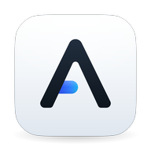
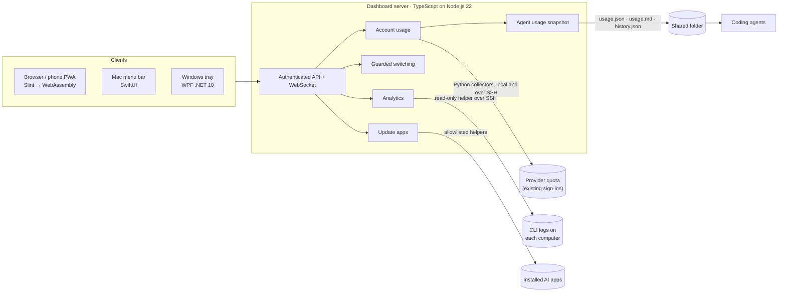

<div align="center">



# AI Account Center

**One dashboard for every AI coding subscription you pay for.**

See every quota at a glance · switch accounts before you hit a limit · let your agents check their own burn rate

<p>


</p>

[**Demo**](#-demo) · [**Features**](#-features) · [**Screenshots**](#-screenshots) · [**How it works**](#%EF%B8%8F-how-it-works) · [**Get started**](#-get-started) · [**Docs**](docs/README.md)

</div>

---

## 🎬 Demo


---

## ✨ Features

| Feature | What you get |
| --- | --- |
| 📊 **Every quota on one screen** | 9 providers, with multiple accounts for supported providers: 5-hour, weekly and monthly limits, credits, packs and resets. |
| 🔁 **Automatic account switching** | Codex moves to an account with room when the active one reaches your limit (95% by default). Only while Codex is idle, with rollback. |
| 🤖 **Usage your agents can read** | Every minute, usage, burn rate and projected run-out land in a shared folder. Agents check before a long run. |
| ⬆️ **Update every AI app at once** | One button updates Claude Code, Codex, both desktop apps, T3 Code and more, on every computer, in parallel. |
| 📈 **Analytics** | Tokens and API-equivalent cost from the CLI logs on every computer, by provider, model, hour and session. |
| 📱 **Phone app** | The full dashboard as an installable PWA, light or dark. |
| 🖥️ **Native trays** | A SwiftUI menu-bar app for the Mac and a WPF tray for Windows, with Activate and Open buttons. |
| 🔐 **Locked down** | Its own login, revocable per-device keys for the trays, HTTPS-proxy support, secrets kept out of logs. |
| 🧾 **Honest numbers** | A missing reading shows as unavailable, never 0%. Cached readings say so and keep their real time. |

**Providers:** Claude · Codex · Google Antigravity · Cursor · Muse Code · Kimi Code · Qwen Token Plan · Z.ai Coding Plan · OpenCode Go

---

## 📸 Screenshots

> Click any screenshot to open it at full resolution.

<table>
<tr>
<td width="50%" valign="top">

<p><b>🏠 Home</b><br>Every account, every limit. Colors warn as a limit fills; the dark tick is the auto-switch point.</p>
</td>
<td width="50%" valign="top">

<p><b>🌙 Dark theme</b><br>Light, dark or follow the system, everywhere: web, phone and both trays.</p>
</td>
</tr>
<tr>
<td width="50%" valign="top">

<p><b>📈 Analytics</b><br>Totals, the usage trend and cost by model and token type.</p>
</td>
<td width="50%" valign="top">

<p><b>🕒 Sessions and habits</b><br>Sessions, cache savings and when you actually use the CLIs.</p>
</td>
</tr>
<tr>
<td width="50%" valign="top">

<p><b>📉 Quota history</b><br>Each account's limit over the week, plus every upcoming reset.</p>
</td>
<td width="50%" valign="top">

<p><b>🛡️ Guarded switching</b><br>A manual switch while Codex is busy lists exactly what will stop first.</p>
</td>
</tr>
<tr>
<td colspan="2">

<p><b>⚙️ Accounts & Settings</b><br>Add or remove accounts, choose what shows where, sign-in and device security, auto-switch policies and update results.</p>
</td>
</tr>
<tr>
<td colspan="2">

<p><b>📱 Phone app (PWA)</b><br>Install it from Safari or Chrome. The same live data, laid out for one hand.</p>
</td>
</tr>
<tr>
<td width="50%" valign="top">

<p><b>🍎 Mac menu bar</b> (<a href="https://raw.githubusercontent.com/sittingmongoose/ai-account-center/main/assets/screenshots/tray-mac-dark.png">dark</a>)<br>SwiftUI. Opens from the menu bar or ⌥⌘A.</p>
</td>
<td width="50%" valign="top">

<p><b>🪟 Windows tray</b> (<a href="https://raw.githubusercontent.com/sittingmongoose/ai-account-center/main/assets/screenshots/tray-win-light.png">light</a>)<br>WPF on .NET 10. Opens from the tray or Ctrl+Alt+A.</p>
</td>
</tr>
</table>

<sub>How these images were made: [screenshot provenance](assets/screenshots/README.md).</sub>

---

## 🧩 Supported providers

| Provider | What you see | Switch accounts | How it signs in |
| --- | --- | --- | --- |
| **Claude** | 5-hour, weekly, Fable (Max plans), extra usage | Opens each account's own desktop profile on the Mac or Windows | Desktop profile |
| **Codex** | 5-hour, weekly, credits, banked resets | ✅ Activate + automatic (Linux) | Device code |
| **Google Antigravity** | Gemini and Claude/GPT pools, 5-hour and weekly | ✅ Activate (Linux), automatic is opt-in | Supervised CLI login |
| **Cursor** | Included usage, on-demand spend | — | Desktop app session |
| **Muse Code** | 5-hour and weekly | — | Existing `muse login` on the Mac (dashboard device-code sign-in is off by default) |
| **Kimi Code** | 5-hour and weekly | — | API key |
| **Qwen Token Plan** | Monthly credits, packs, plan expiry | — | Console session (browser extension) |
| **Z.ai Coding Plan** | Token windows, monthly requests, reset packs | — | API key |
| **OpenCode Go** | 5-hour, weekly, monthly, console wallet | — | API key |

<sub>Cursor, Muse Code and Qwen hold one account each; the others take up to 16 accounts per provider.</sub>

---

## 🔍 Feature deep dives

### 🔁 Automatic account switching

- **Set a limit.** Turn on Auto-switch and pick when to move (95% used by default).
- **It watches.** Every minute it checks the active Codex account against fresh provider readings.
- **It waits for idle.** It never cuts off running work; it switches once Codex is idle.
- **It's a transaction.** Prove the identity → swap the login → verify → roll back if anything is off.
- **You stay in control.** A manual switch while Codex is busy shows the review above: the exact processes that will stop.
- **Logins stay fresh.** Idle saved Codex logins renew themselves about four days before they expire. The login in use is never touched.
- **Antigravity too.** The same guarded switch works for Antigravity CLI accounts on Ubuntu. Automatic switching there is opt-in and off by default.

### 🤖 Usage your agents can read

Long agent runs die when an account hits its limit. So the dashboard publishes its readings where every agent can see them.

- **Turn it on:** `ai-account-center dashboard usage-snapshot set /path/to/shared/folder`
- **Every refresh** (one minute by default) it writes `usage.json`, `usage.md` and 7 days of `history.json`.
- **Burn rate** over the last 5 and 15 minutes, 1, 6 and 24 hours, with a projected run-out time.
- **The key flag:** `BEFORE the reset` means the account runs dry at the current pace.
- **Zero setup for agents:** a dependency-free reader, `aac-usage`, ships into the folder. `aac-usage install-rules` adds a short block to Claude, Codex, OMP, Gemini, ZCode and T3 rules files so agents know to check.
- **Private by design:** fields are copied from an allowlist. Tokens, file paths and raw provider answers never reach the folder.
- **T3 Code bonus:** a built-in usage hub feeds T3 Code's own quota bars ([T3 usage hub](docs/t3-usage-hub.md)).

```text
$ aac-usage --provider claude
Claude
  work  work@example.com  [max, Windows]  current, sampled 2m ago
    Five-hour usage: 68% used (32% left); resets 05:03 UTC (in 2h 38m); pace 22.50%/h over 15 min,
      14.20%/h over 1 h, full in 1h 25m BEFORE the reset
    Weekly usage: 76% used (24% left); resets Oct 20 20:23 UTC (in 4d 17h); pace 2.60%/h over 15 min,
      1.90%/h over 1 h, full in 9h 13m BEFORE the reset
```

Details: [agent usage snapshot](docs/agent-usage-snapshot.md).

### ⬆️ Update every AI app at once

- **One button** in the header starts one job for every computer.
- **10 apps:** Claude Code, Claude Desktop, Codex CLI, Codex Desktop, T3 Code and its ACP adapters, Antigravity CLI, Muse Code, OMP and ZCode.
- **Parallel:** each computer updates its own apps while the others run, with live progress per computer.
- **Safe restarts:** only CLI sessions running in a terminal are stopped and reopened. Background agents are never killed.
- **Nothing automatic:** updates run only when you press the button. Cancel skips whatever hasn't started.
- **Reviewed builds only** for the Antigravity CLI, so account switching never meets an unreviewed version.

### 📈 Analytics

- **Reads the logs you already have:** Claude Code, Codex, OMP, Muse, ZCode and Antigravity on every computer.
- **Nothing private leaves a computer:** a pinned, read-only helper sends back hourly totals per model. No session ids or paths.
- **See it:** totals, trends, cost by model and token type, cache efficiency, sessions, a weekday × hour heatmap, daily cost by provider, quota history and upcoming resets.
- **Pick a range:** 24 hours, 7 or 30 days, this month, everything, or custom dates. Always in your time zone.
- **Costs are estimates** at public list rates (what the same tokens would cost on the API), not your subscription bill. A model with no listed rate shows "Not logged", never $0.

### 📱 Phone app (PWA)

- **Responsive** down to small phones; **installable** from Safari (Add to Home Screen) or Chrome (Install app).
- **Remembers you:** sign-ins survive server restarts (7 days by default, adjustable from 1 day to 1 year).
- **Password managers** fill the sign-in form.
- **No stale numbers:** usage is never stored on the phone. Offline, it says so.

### 🖥️ Native trays

- **Mac:** SwiftUI menu-bar app (macOS 26+). The menu bar can show one live reading, used or remaining.
- **Windows:** WPF tray app on .NET 10. Single instance; a second launch opens the running one.
- **Same powers:** every account, Activate, open a Claude profile, auto-switch toggles and thresholds.
- **Your choice of accounts:** "Show in tray" is separate from "Show on dashboard".
- **Pair once:** the tray trades the dashboard password for its own revocable key, which rotates every 30 days. Changing the password never signs a tray out.

### 🔐 Security

- **Its own login,** separate from every provider login, with rate limits and lockout countdowns.
- **Secure transport for secrets:** keys, codes and passwords travel only over HTTPS, the dashboard computer itself, or a home network you explicitly trust.
- **Remote access:** put it behind your own HTTPS reverse proxy with `ai-account-center dashboard proxy set`. Full setup, including an nginx example, is in the [user guide](docs/user-guide.md#dashboard-sign-in-devices-and-pairing).
- **Sessions you can see:** list and revoke paired trays, sign out other browsers or every device.
- **Safety nets in CI:** a personal-detail guard and credential redaction keep secrets and real identities out of the repo and logs.

### 🧾 Honest numbers

- **Missing ≠ zero.** A reading that didn't arrive is drawn as unavailable.
- **Cached means cached.** A cached reading keeps its real sample time.
- **Resets are honest.** Once a reset time passes, the bar reads "new reading pending" until a fresh one arrives.
- **Failover with proof.** If one computer can't read an account, another computer signed in to the *same verified account* can fill in. Unknown identities are never guessed.

---

## 🏗️ How it works



| Layer | Built with |
| --- | --- |
| Backend | TypeScript on Node.js 22: Express, WebSocket, structured logging |
| Web UI | [Slint](https://slint.dev) 1.18.1, compiled from Rust to WebAssembly and drawn with WebGL2; installable PWA |
| Mac app | Swift and SwiftUI menu-bar app |
| Windows app | C# and WPF on .NET 10 |
| Collectors and helpers | Python usage collectors, analytics and update helpers over SSH; browser extensions for console sessions |
| Packaging | Bun and npm (local tarball), Docker |

The setup it was built for: a **Linux server** runs the dashboard, and a **Mac** and a **Windows PC** are reached over SSH for Claude desktop profiles, the trays, Analytics and updates. On a single Linux computer you still get the dashboard, Codex and Antigravity switching, local Analytics and every API-key provider. Codex and Antigravity switching need the dashboard on Linux. Deeper reading: [system architecture](docs/system-architecture/index.md).

---

## 🚀 Get started

### What you need

| For | You need |
| --- | --- |
| The dashboard | Node.js 22, [Bun](https://bun.sh/docs/installation) 1.3.9, [Rust](https://rust-lang.org/tools/install/) 1.92+ with `wasm32-unknown-unknown` and [wasm-pack](https://github.com/wasm-bindgen/wasm-pack#installation) |
| Usage readings | Your existing provider sign-ins on the computer that owns them, and Python 3 there (`/usr/bin/python3` on Linux and Mac, `python.exe` on Windows) |
| Mac / Windows features | SSH access from the dashboard computer, and Python 3 on the remote computer |
| Codex / Antigravity switching | The dashboard on Linux (activation refuses other platforms) |
| Mac menu bar | macOS 26+, Xcode 26+ |
| Windows tray | Windows x64, [.NET 10 SDK](https://dotnet.microsoft.com/en-us/download/dotnet/10.0) |
| Browser | WebGL2 with hardware acceleration |

### 1️⃣ Build

```bash
git clone https://github.com/sittingmongoose/ai-account-center.git
cd ai-account-center
bun install --frozen-lockfile
rustup target add wasm32-unknown-unknown
bun run build:all
```

### 2️⃣ Run

```bash
./scripts/dev-install.sh --npm                 # build, validate and install the `ai-account-center` command
ai-account-center dashboard auth setup         # the dashboard's own username and password
ai-account-center dashboard --host localhost --port 3000 --no-open
```

Open `http://localhost:3000`. Prefer not to install? `node dist/ccs.js dashboard` runs straight from the checkout.

### 3️⃣ Add accounts

Use **Accounts & Settings → Add account**, or save the Codex login you're already signed in to:

```bash
ai-account-center codex-auth import-default personal
```

### 4️⃣ Install a tray (optional)

```bash
# Mac
cd macos-bar && ./Scripts/package_app.sh && ./Scripts/install_user.sh --launch
```

```powershell
# Windows PowerShell
cd windows-bar; ./scripts/Build.ps1; ./scripts/Install.ps1
```

On first run, give the tray the dashboard address and password once. Guides: [Mac](macos-bar/README.md) · [Windows](windows-bar/README.md).

### 5️⃣ Let your agents see usage (optional)

```bash
ai-account-center dashboard usage-snapshot set /path/to/shared/folder
python3 /path/to/shared/folder/aac-usage install-rules   # on each computer your agents use
```

<!-- quickstart-snippet-start -->
## Quick Start (Docker)

From a checkout of [AI Account Center](https://github.com/sittingmongoose/ai-account-center):

```bash
docker compose -f docker/compose.yaml up -d --build
```

Open `http://localhost:3000`. This builds the local source image;
it does not download the upstream CCS package or start a CLIProxy service.
Existing host credentials and usage-collector connections require explicit
configuration; see the Docker deployment guide in this checkout.
<!-- quickstart-snippet-end -->

More: [Docker guide](docker/README.md) · [phone install](docs/user-guide.md#use-it-on-your-phone) · [remote access](docs/user-guide.md#dashboard-sign-in-devices-and-pairing)

---

## ⌨️ Commands

| Command | What it does |
| --- | --- |
| `ai-account-center dashboard` | Run the dashboard (`--host`, `--port`, `--no-open`) |
| `ai-account-center dashboard auth setup` | Set the dashboard's own login (`show`, `disable`) |
| `ai-account-center dashboard usage-snapshot set <folder>` | Publish usage for agents (`status`, `off`) |
| `ai-account-center dashboard usage-hub status` | T3 Code usage hub (`generate`, `rotate`, `off`) |
| `ai-account-center dashboard proxy set --address <ip> --origin <url>` | Trust your HTTPS reverse proxy (`status`, `off`) |
| `ai-account-center codex-auth show` | List saved Codex logins (`create`, `login`, `import-default`, `remove`) |
| `ai-account-center codex-auth activate <name>` | Guarded switch of the shared Codex login |
| `ai-account-center antigravity signin <profile>` | Add or re-sign an Antigravity profile on Ubuntu |
| `ai-account-center antigravity status` | Read-only check of what Antigravity switching needs |
| `ai-account-center bar` | Mac: start the local dashboard and open the menu-bar app |

`ai-account-center help <command>` has every option. The older `ccs` command runs the same commands, and **`ccs config` still opens the dashboard**.

---

## 📚 Documentation

| Read this | For |
| --- | --- |
| [User guide](docs/user-guide.md) | Every page and control, sign-in flows, phone install, remote access, update and rollback, known limits |
| [Agent usage snapshot](docs/agent-usage-snapshot.md) | The shared-folder format and reader |
| [Codex switching](docs/codex-auth.md) · [activation review](docs/activate-in-place.md) | How the guarded switch works |
| [Antigravity on Ubuntu](docs/antigravity-runtime.md) | Profiles, sign-in and switching gates |
| [System architecture](docs/system-architecture/index.md) | Data, credential and host boundaries |
| [Dashboard (Slint)](web-dashboard/README.md) | The WebAssembly UI and its licensing |
| [All maintainer docs](docs/README.md) | Everything else |

---

## 🛠️ Development

```bash
bun run validate      # typecheck, lint, format, fast tests
bun run test:all      # the full suite
bun run ui:validate   # the compiled Slint UI matches its sources
```

See [Contributing](CONTRIBUTING.md) and the [test guide](tests/README.md). Never test against your real `~/.ccs/`: point `CCS_HOME` at a temporary folder. Report bugs in [issues](https://github.com/sittingmongoose/ai-account-center/issues); keep tokens, cookies and real account details out of them ([Security](SECURITY.md)).

### How it's built

- **Fast:** forked from CCS on September 30, 2026. Since then: 740+ commits and a net ~288k lines added and ~380k removed against the fork point, turning a CLI router into this product.
- **Polyglot:** ~100k lines of TypeScript, ~24k of Python, ~22k of Slint, ~16k of Swift and ~13k of C#, plus 426 test files.
- **Agent-built, human-directed:** 529 of those commits are co-authored by AI coding agents (Claude, GPT, Qwen, GLM, Kimi and Muse models) working in parallel. Larger changes get independent reviews from a different model family before they ship.
- **Dogfooded:** the agents that build it run on the accounts it manages, and read their own burn rate from it.

<sub>Counted on October 16, 2026, from the fork point (`f45fa923`, the CCS 8.10.0 release) to commit `7adad8c5`. Line counts are physical lines of tracked files (comments and blank lines included), excluding test files and anything in a `test`, `tests` or `__tests__` folder. Test files are `*.test.*`, `*.spec.*`, `test_*.py` and `*_test.py`.</sub>

---

## 🔄 Coming from CCS?

This is the continuing fork of [CCS](https://github.com/kaitranntt/ccs), now at
[sittingmongoose/ai-account-center](https://github.com/sittingmongoose/ai-account-center).
Your data stays where it is: `~/.ccs/`, `CCS_HOME`, profile and provider IDs, session aliases
and native messaging identities all keep working, and nothing needs renaming. The old
runtime router (`ccsx`, `ccs-codex`, `ccsd`, `ccs-droid`, `ccsxp`) is retired; those commands now
print migration guidance. Details: [user guide](docs/user-guide.md#existing-ccs-installations).

## 🙏 Attribution and license

The original CCS project was created by **Tam Nhu Tran (Kai)** and the **CCS
Contributors**. Original package author metadata and
`Copyright (c) 2025 CCS Contributors` remain under the unchanged
[MIT license](LICENSE). Upstream source and history remain at
[kaitranntt/ccs](https://github.com/kaitranntt/ccs).

Slint 1.18.1 uses its royalty-free license; the dashboard keeps the standard
AboutSlint widget ([dashboard licensing](web-dashboard/README.md#dependencies-and-attribution)).
Provider artwork keeps its [source and attribution notices](web-dashboard/public/assets/THIRD-PARTY-NOTICES.txt).
Original CCS routing work credited
[claude-code-router](https://github.com/musistudio/claude-code-router), and the
original project used [ClaudeKit](https://claudekit.cc).
[opencode-ccs-sync](https://github.com/JasonLandbridge/opencode-ccs-sync), by
[@JasonLandbridge](https://github.com/JasonLandbridge), serves the original CCS
provider configuration; its credit is kept and does not imply current dashboard integration.
Star history: [original CCS](https://star-history.com/#kaitranntt/ccs&Date).
